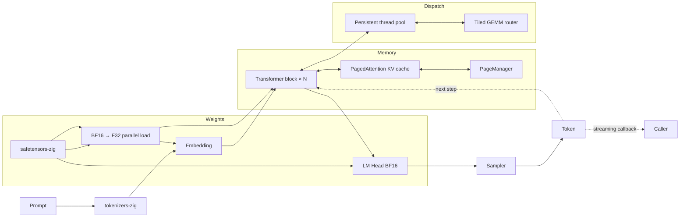

# vllm-zig

> Pure-Zig LLM serving substrate — paged attention, BF16 kernels, persistent thread-pool dispatch.

[](https://github.com/SMC17/vllm-zig/actions)
[](LICENSE)
[](https://ziglang.org/)
[](#tests)

## What ships (v0.0.6)

- Real end-to-end TinyLlama-1.1B inference through pure-Zig kernels
- Persistent Linux-futex-backed worker pool + tiled-GEMM dispatch routing
- BF16 `lm_head` matmul (halves B-matrix bandwidth pulled through L2/L3
  on the largest decode-time matmul: M=1, K=2048, N=32000)
- PagedAttention KV substrate (`page_manager.zig` + `paged_attention.zig`):
  K and V planes split, 64-byte-aligned, per-block per-head views
- Streaming `generate()` — each decoded token emitted via caller callback
- Parallel BF16→F32 weight load (safetensors-zig as a path dependency)
- 77/77 unit tests pass; SIMD ↔ scalar matmul agreement across 7
  `(M, K, N)` shape variants

## What does NOT ship yet

- Continuous batching + OpenAI HTTP front-end → Phase 2
- BEAM/OTP scheduler (LiveDashboard / `:observer`) → Phase 2/3
- CUDA / Triton GPU kernels → Phase 1.5+, hardware-gated on Ampere+
- Speculative decoding
- Multi-GPU

## Quickstart

```sh
zig build test                  # 77 unit tests
zig build forward-skeleton      # Wiring smoke test
zig build bench-matmul          # Matmul scalar vs SIMD speedup table
zig build bench-pool            # Persistent pool vs ad-hoc spawn
zig build bench-tiled           # Cache-tiled vs non-tiled matmul
zig build infer-tinyllama       # End-to-end TinyLlama inference
zig build bench-tinyllama-pool  # TinyLlama pool vs no-pool head-to-head
zig build install -Doptimize=ReleaseFast
```

## Architecture



### Kernels

- **`tensor.zig`** — `Matrix` (f32, row-major, owned slice). Approximate-equality
  helper for SIMD/scalar cross-validation.
- **`kernels/matmul.zig`** — scalar reference, SIMD outer-product,
  multi-thread row-split (M-axis), multi-thread col-split (N-axis), and
  `matmulSIMDAuto` dispatcher choosing row-vs-col split by M vs n_threads.
  9–16x SIMD speedup over scalar at N ≤ 512.
- **`kernels/matmul_bf16.zig`** — BF16 B-matrix matmul (scalar + SIMD),
  routed by `forward.zig` for the decode-time `lm_head`.
- **`kernels/rmsnorm.zig`** — Llama-style RMSNorm with SIMD inner loop.
- **`kernels/softmax.zig`** — numerically stable softmax (subtract max).
- **`kernels/silu.zig`** — SiLU + `siluMul` (Llama-MLP `silu(gate) * up`).
- **`kernels/rope.zig`** — RoPE rotation matching the Triton reference.
- **`kernels/attention.zig`** — GQA causal attention with KV cache.

### Forward pass + weights

- **`src/bf16.zig`** — BF16 ↔ F32 (exact BF16→F32, round-to-nearest-even F32→BF16).
- **`src/weights.zig`** — `loadMatrixBF16` / `loadVectorBF16` /
  `loadMatrixBF16Transposed`. Parallel BF16→F32 load.
- **`src/kv_cache.zig`** — per-layer fixed-size KV cache (~92 MB for
  TinyLlama at `max_seq=2048`).
- **`src/page_manager.zig`** — physical block backing store for
  PagedAttention (K/V planes, 64-byte-aligned).
- **`src/paged_attention.zig`** — block-indexed attention over the page
  manager.
- **`src/thread_pool.zig`** — persistent Linux-futex worker pool;
  replaces ad-hoc `std.Thread.spawn` cost at M=1 decode.
- **`src/sampler.zig`** — greedy / temperature / top-K sampling.
- **`src/model.zig`** — full Llama-family Model (Config from
  `config.json`, LayerWeights, `loadFromSafeTensors`, `forward` = embed →
  N × block → final norm → lm_head BF16 → logits).
- **`src/forward.zig`** — block-level forward; routes the BF16 lm_head
  matmul.

## End-to-end on TinyLlama-1.1B-Chat-v1.0 (consumer Linux, 8 cores)

```
prompt: "The capital of France is"  (max_new=8, ReleaseFast, T=8)

(A) no pool — matmulSIMDAuto (v0.0.4)
    first-token (prefill+1):  8716 ms
    decode ms/tok:            3369

(B) persistent pool (v0.0.5/v0.0.6)
    first-token (prefill+1):  7076 ms
    decode ms/tok:            1330       (v0.0.6 measured under load avg ~44)
```

The v0.0.6 1330 ms/tok number was measured at **load average ~44 on an
8-core CPU**, not a clean machine — see `STATUS.md` Type-II watch for the
honest accounting. The historical 581 ms/tok baseline was on a clean
machine; do not compare across noise floors.

Real model behavior, real kernels, real tokens streamed out. The 25-second
model load is parallel BF16→F32 (2.3x v0.0.3). The 1.6x prefill is
multi-thread matmul row-split. The v0.0.4 decode regression (`std.Thread.spawn`
cost dominating at M=1) was closed by the persistent worker pool.

## How this fits the portfolio

- **Upstream:** [`SMC17/safetensors-zig`](https://github.com/SMC17/safetensors-zig)
  (weight loader), [`SMC17/tokenizers-zig`](https://github.com/SMC17/tokenizers-zig) (BPE)
- **Companion:** BEAM/OTP multi-agent on top — the scheduler-layer
  swap is the load-bearing architectural choice; see `ARCHITECTURE.md`.
- vLLM (Kwon et al. 2023) is the reference architecture this echoes;
  vllm-zig replaces the Python scheduler with a future BEAM/OTP layer
  and the kernels with Zig.

## Non-claims

- **This is NOT vLLM.** No continuous batching, no speculative decoding,
  no multi-GPU. vLLM (the upstream) is years of optimisation + production
  GPU/CUDA scheduling. Fair comparison requires Phase 2.
- **CPU only.** No GPU code at v0.0.6. Per `ARCHITECTURE.md`, GPU paths
  are hardware-gated on Ampere+.
- **Decode benchmarks are CPU-only on TinyLlama-1.1B** — not comparable
  to GPU production serving.
- **Pre-1.0 substrate** per the Zig 0.16 ecosystem convention. The BF16 +
  tiled-pool work is substrate, not a release-readiness claim. Vocabulary
  stays below "production-grade" until the evidence changes.

## Tests

77/77 unit tests pass at v0.0.6 (`zig build test`). SIMD ↔ scalar
matmul agreement verified across 7 `(M, K, N)` shape variants. The
`forward-skeleton`, `infer-tinyllama`, and `bench-tinyllama-pool`
steps exercise the full pipeline end-to-end against real weights.

## See also

- `ARCHITECTURE.md` — full design doc (16 sections, ~400 lines)
- `STATUS.md` — phase-by-phase status (incl. Type-II watch on the v0.0.6 bench number)
- `CHANGELOG.md` — version-by-version delta

## License

AGPL-3.0-or-later. See `LICENSE`. AGPL on server software means SaaS
deployment requires releasing modifications or negotiating a commercial
license. Standard sovereign-stack posture.
